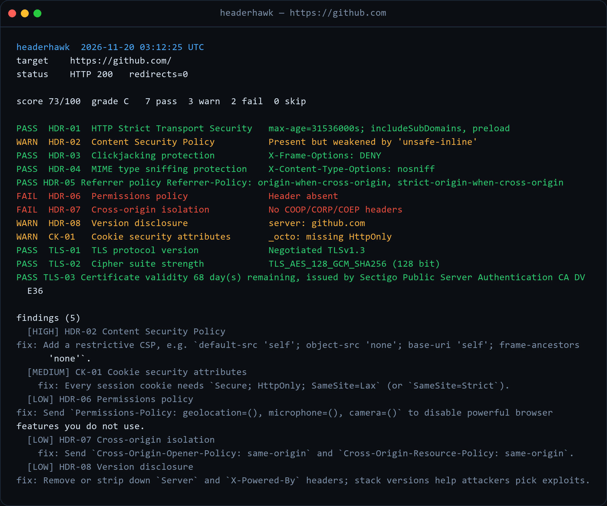
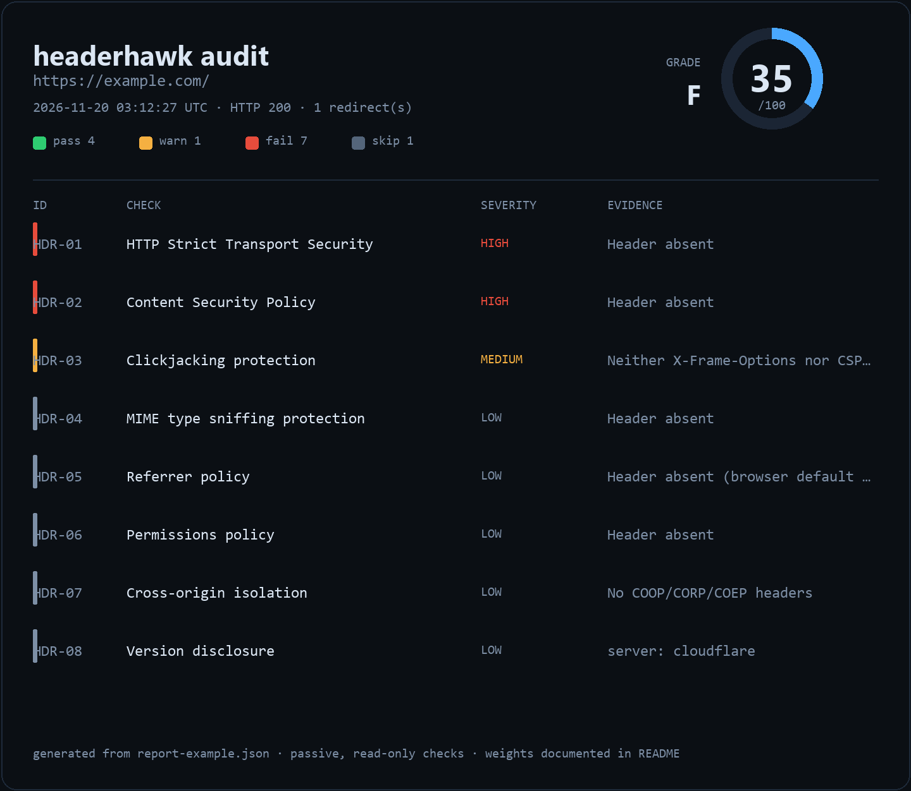
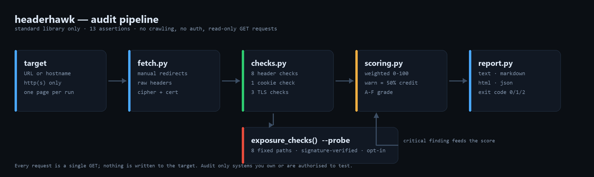

# headerhawk

A single-file-in-spirit HTTP security auditor: it fetches one URL, checks the
headers, cookies and TLS configuration that actually stop attacks, probes a
short list of accidentally published files, and turns the result into a
weighted 0–100 score with a letter grade and a report you can hand to a client.

No dependencies. No crawling. No exploitation. Standard library only.

```
python -m headerhawk https://example.com
```



---

## Why this exists

Most "security header checkers" are web services that give you a grade and
nothing else. That is useless in a real audit, because a client does not need a
grade — they need *what is missing, why it matters, and the exact line to add*.

`headerhawk` is built for the report side of that job:

- every failing check carries the header value to send, not just "missing"
- TLS is read from the live handshake (protocol, cipher, certificate expiry),
  not inferred from a header
- a JSON output exists so the same data can feed a dashboard or a spreadsheet
- the scoring model is documented and deterministic, so two runs are comparable

## What it checks

13 assertions across four categories. Weights sum to 100 when `--probe` is on;
`skip`ped checks are removed from both numerator and denominator.

### Headers — 60 points

| ID | Check | Weight | Fails when |
| --- | --- | --- | --- |
| HDR-01 | HTTP Strict Transport Security | 12 | header absent; `max-age` below 180 days is a warning |
| HDR-02 | Content Security Policy | 12 | absent, or weakened by `'unsafe-inline'`, `'unsafe-eval'`, wildcard source |
| HDR-03 | Clickjacking protection | 8 | neither `X-Frame-Options` nor CSP `frame-ancestors` |
| HDR-04 | MIME sniffing protection | 8 | `X-Content-Type-Options: nosniff` absent |
| HDR-05 | Referrer policy | 6 | absent, or `unsafe-url` |
| HDR-06 | Permissions policy | 4 | absent |
| HDR-07 | Cross-origin isolation | 5 | no COOP / CORP / COEP header |
| HDR-08 | Version disclosure | 5 | `Server`, `X-Powered-By`, `X-AspNet-Version` leak stack versions |

### Cookies — 12 points

| ID | Check | Weight | Fails when |
| --- | --- | --- | --- |
| CK-01 | Cookie security attributes | 12 | a cookie is missing `Secure`, or uses `SameSite=None` without `Secure`; missing `HttpOnly`/`SameSite` is a warning |

### TLS — 15 points

| ID | Check | Weight | Fails when |
| --- | --- | --- | --- |
| TLS-01 | Protocol version | 8 | negotiated TLS 1.0/1.1 or SSLv3 |
| TLS-02 | Cipher strength | 4 | RC4, 3DES, NULL, EXPORT or anonymous suite negotiated |
| TLS-03 | Certificate validity | 3 | expired; under 15 days is a warning |

### Exposure probes — 13 points (opt-in, `--probe`)

| ID | Check | Weight | Fails when |
| --- | --- | --- | --- |
| EXP-01 | Sensitive path exposure | 13 | one of 8 fixed paths returns a *signature-verified* leak |

Probed paths: `/.git/HEAD`, `/.env`, `/.svn/entries`, `/.DS_Store`,
`/phpinfo.php`, `/server-status`, `/actuator/env`, `/wp-config.php.bak`.

A `200` is not enough to call something a leak — many sites answer `200` with a
soft-404 page. Each path has a signature check (for example `/.git/HEAD` must
start with `ref:` or a 40-character object id) before it is reported.

## Scoring

```
score = 100 × Σ(weight × credit) / Σ(weight)     credit: pass 1.0 · warn 0.5 · fail 0
```

| Score | Grade | Meaning |
| --- | --- | --- |
| 90–100 | A | Hardened |
| 80–89 | B | Good |
| 70–79 | C | Needs work |
| 60–69 | D | Weak |
| 0–59 | F | Failing |

Warnings earn half credit on purpose: a CSP with `'unsafe-inline'` is not the
same as no CSP at all, and a model that treats them identically stops being
useful for prioritisation.

Exit codes: `0` all checks pass, `1` at least one check failed, `2` the target
could not be fetched (DNS, TCP, TLS verification).

## Install

Python 3.9+ is the only requirement. There is nothing to install.

```bash
git clone <this-repo>
cd headerhawk
python -m headerhawk https://example.com
```

Or run the shim without thinking about modules:

```bash
python headerhawk.py https://example.com
```

## Usage

```
headerhawk [-h] [--probe] [--timeout SECONDS] [--format {text,md,html,json}]
           [--out DIR] [--user-agent STRING] [--cacert PATH] [--insecure]
           [--no-color] [--quiet] [--version] target
```

| Flag | What it does |
| --- | --- |
| `--probe` | enable the 8 sensitive-path probes (adds 8 GET requests) |
| `--format` | stdout format: `text` (default), `md`, `html`, `json` |
| `--out DIR` | also write `report.md`, `report.html`, `report.json` into `DIR` |
| `--cacert PATH` | explicit CA bundle when auto-detection picks the wrong one |
| `--insecure` | skip certificate verification (audit a broken staging box) |
| `--timeout` | per-request timeout, default 10s |
| `--quiet` | write files only, no stdout — for cron and CI |
| `--no-color` | plain text, for logs and screenshots |

### Examples

Audit a site and print the summary:

```bash
python -m headerhawk example.com
```

Full audit with exposure probes, all report formats, no console noise:

```bash
python -m headerhawk example.com --probe --out reports --quiet
```

Pipe JSON into something else:

```bash
python -m headerhawk example.com --format json | jq '.score, .counts'
```

Fail a CI job when the grade drops below B:

```bash
python -m headerhawk https://staging.example.com --format json --quiet --out artifacts \
  && jq -e '.score >= 80' artifacts/report.json
```

## Sample output

Real run against `https://github.com` (captured in
[`examples/demo-output.txt`](examples/demo-output.txt)):

```
headerhawk  2026-11-20 03:12:25 UTC
target    https://github.com/
status    HTTP 200   redirects=0

score 73/100  grade C   7 pass  3 warn  2 fail  0 skip

PASS  HDR-01  HTTP Strict Transport Security   max-age=31536000s; includeSubDomains, preload
WARN  HDR-02  Content Security Policy          Present but weakened by 'unsafe-inline'
PASS  HDR-03  Clickjacking protection          X-Frame-Options: DENY
PASS  HDR-04  MIME type sniffing protection    X-Content-Type-Options: nosniff
PASS  HDR-05  Referrer policy                  Referrer-Policy: origin-when-cross-origin, strict-origin-when-cross-origin
FAIL  HDR-06  Permissions policy               Header absent
FAIL  HDR-07  Cross-origin isolation           No COOP/CORP/COEP headers
WARN  HDR-08  Version disclosure               server: github.com
WARN  CK-01   Cookie security attributes       _octo: missing HttpOnly
PASS  TLS-01  TLS protocol version             Negotiated TLSv1.3
PASS  TLS-02  Cipher suite strength            TLS_AES_128_GCM_SHA256 (128 bit)
PASS  TLS-03  Certificate validity             68 day(s) remaining, issued by Sectigo Public Server Authentication CA DV E36

findings (5)
  [HIGH] HDR-02 Content Security Policy
    fix: Add a restrictive CSP, e.g. `default-src 'self'; object-src 'none'; base-uri 'self'; frame-ancestors 'none'`.
  … (4 more findings in the captured file)
```

A second example, `example.com` with `--probe`, is committed as
[`examples/report-example.md`](examples/report-example.md),
[`.html`](examples/report-example.html) and
[`.json`](examples/report-example.json). The summary card below is rendered
directly from that JSON — no numbers are typed by hand:



## Architecture



| Module | Responsibility |
| --- | --- |
| `headerhawk/fetch.py` | one GET per hop, manual redirect handling, captures protocol/cipher/certificate from the live socket, CA bundle auto-detection |
| `headerhawk/checks.py` | the 13 assertions, each a pure function of the fetched response |
| `headerhawk/scoring.py` | weighted score and grade bands |
| `headerhawk/report.py` | text, Markdown, JSON and a self-contained HTML page (inline CSS, no CDN) |
| `headerhawk/cli.py` | argument parsing, orchestration, exit codes |
| `tools/` | image generators for this README (they read the JSON report, so the images cannot drift from real output) |

Design notes:

- **TLS metadata is captured before the body is read.** `http.client` detaches
  the socket after a `Connection: close` response, so `conn.sock` is `None` by
  the time the body is in hand. The handshake data has to be taken first.
- **CA bundles are auto-detected.** CPython on Windows often reports a
  partially populated default store, so a non-zero certificate count is not
  proof that verification will work. The tool prefers `SSL_CERT_FILE`,
  `certifi`, or a known bundle path, and only falls back to the platform store.
- **HTML reports are self-contained.** One file, inline CSS, no external
  requests — it can be attached to a client email without breaking.

## Tests

```bash
python -m unittest discover -s tests -v
```

31 tests, no network access: every response is constructed by hand, so the
suite is deterministic and runs offline. Covered: HSTS parsing, CSP weakness
detection, clickjacking fallbacks, cookie attribute combinations, TLS protocol
and cipher and expiry branches, grade bands, exposure signatures, and all four
report renderers.

```
Ran 31 tests in 0.001s

OK
```

## Limitations

Being explicit about what this does *not* do:

- **One URL per run.** No crawling, so a site with 40 pages needs 40 runs.
- **No authenticated checks.** Cookies from a real session are not supported;
  only what an anonymous GET returns is inspected.
- **Header-level only.** It does not test whether the CSP actually blocks an
  injection, or whether HSTS is honoured after a downgrade — that needs a
  browser.
- **Exposure probes are a fixed list of 8 paths.** It is not a content
  discovery tool.
- **Certificate checks read the leaf only** — chain order and revocation
  (OCSP/CRL) are not evaluated.
- **Grades are not comparable across tools.** A different weight table gives a
  different number; the value is in the findings, not the letter.

## Ethics and legal

This tool sends real HTTP requests. Only run it against systems you own or have
written permission to test. The default mode is passive (one GET, plus eight
more with `--probe`) and it never attempts exploitation, but unsolicited
scanning can still be illegal in your jurisdiction.

## Roadmap

- [ ] `--compare baseline.json` to diff two scans and show what regressed
- [ ] multi-URL mode with a CSV summary
- [ ] cookie scope analysis across the redirect chain
- [ ] optional `--json-schema` output for CI validators

## License

MIT — see [LICENSE](LICENSE).

---

Built by Fernando Iskandar. Header weights follow OWASP Secure Headers Project
guidance; the scoring model is my own and documented above so you can disagree
with it precisely.
